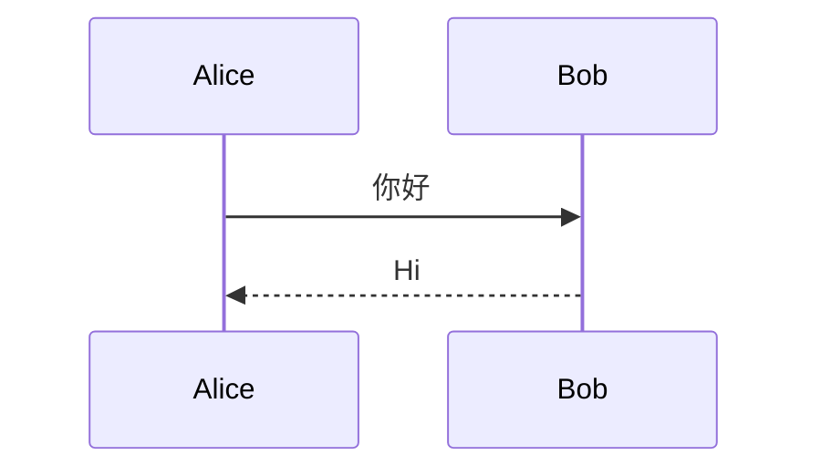

# Heading 1
## Heading 2
### Heading 3
#### Heading 4
##### Heading 5
###### Heading 6

**bold** *italic* ~~strike~~ ***bold italic*** `code` [a link](https://example.com) <https://example.org>

- level 1
  - level 2
    - level 3
1. one
   1. one-one
2. two

- [x] done
- [ ] todo

| Left | Center | Right |
|:-----|:------:|------:|
| l | c | r |

```python
def hello():
    return "世界"
```

> A blockquote
> > nested quote

---


https://i.ibb.co/4Z4TR4Gm/421de6d6f41f.jpg

:rocket: :tada: :white_check_mark: 🎉

<div class="custom-html"><b>HTML</b> snippet <kbd>Ctrl</kbd>+<kbd>P</kbd></div>

<script>window.__xss = 1</script>


\newpage

## After page break


